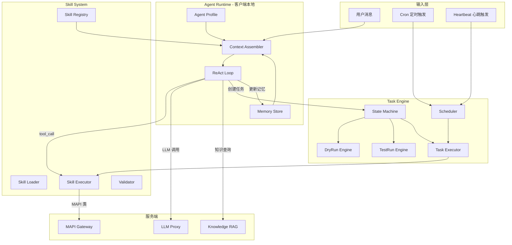
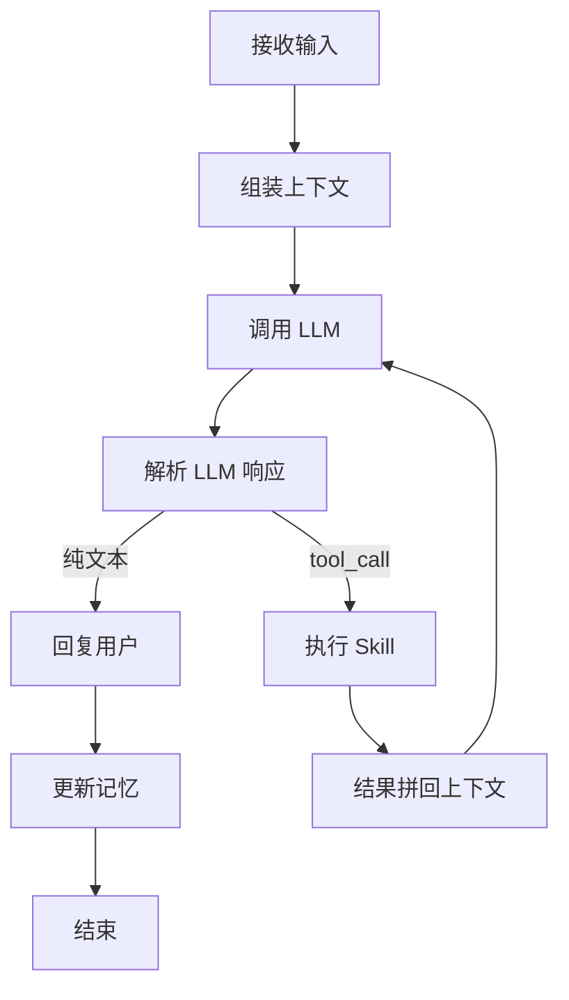
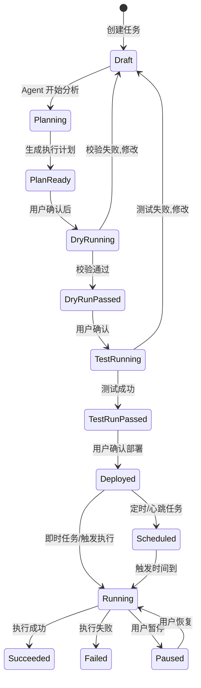

# Admiral 任务系统完整实现方案

## 现状分析

项目已完成 Phase 1-2：认证、OAuth、MAPI 代理、LLM 代理、WebSocket 均已实现。Phase 3（Agent Runtime + Skill）和 Phase 4（任务系统）的代码文件已创建但均为空壳 TODO。

**已有基础设施：**

- [crates/admiral-client/src/network/api_client.rs](crates/admiral-client/src/network/api_client.rs) — REST 客户端（含 `llm_chat`、`mapi_proxy`）
- [crates/admiral-server/src/service/llm_router.rs](crates/admiral-server/src/service/llm_router.rs) — LLM 代理（当前仅 DeepSeek）
- [crates/admiral-client/src/tauri_bridge.rs](crates/admiral-client/src/tauri_bridge.rs) — Tauri IPC 桥接
- [crates/admiral-types/src/api.rs](crates/admiral-types/src/api.rs) — 共享类型定义

**需要实现的空壳文件：**

- `crates/admiral-client/src/agent/` — runtime.rs, context.rs, memory.rs, profile.rs
- `crates/admiral-client/src/task/` — engine.rs, state_machine.rs, executor.rs, scheduler.rs
- `crates/admiral-client/src/skill/` — registry.rs, loader.rs, executor.rs, validator.rs
- `crates/admiral-types/src/` — task.rs, skill.rs

---

## 整体架构（参考 OpenClaw 映射到 Admiral）




---

## 模块一：记忆系统（Memory System）

**设计理念**：仿照 OpenClaw 的 MEMORY.md 方案，以 Markdown 文件为持久存储，辅以 SQLite FTS5 索引实现混合检索。

### 文件存储结构

```
~/.admiral/
  memory/
    USER_MEMORY.md          # 用户层级记忆（偏好、基本信息）
    daily/
      2026-02-24.md         # 每日记忆日志（append-only）
    tasks/
      {task_id}/
        TASK_MEMORY.md      # 任务层级记忆
  agent_profile.toml        # Agent 人格配置
  heartbeat.toml            # Heartbeat 配置
```

### USER_MEMORY.md 格式

```markdown
# User Memory

## Basic Info
- Name: 张三
- Company: XX广告公司
- Work Directory: /Users/xxx/ad-assets

## Preferences
- 报表格式偏好: CSV
- 语言: 中文
- 默认出价策略: oCPC

## Known Facts
- 管理的B站广告账户: 12345, 67890
- 主推目标: 应用下载
```

### 检索策略

- **全量注入**：USER_MEMORY.md 通常 < 2K tokens，每次 LLM 调用时全量注入 system prompt
- **任务记忆**：当前任务的 TASK_MEMORY.md 注入 system prompt
- **每日记忆**：注入当天的 daily note（如果存在）
- **SQLite FTS5 索引**：为跨文件关键词搜索提供支持（用于记忆管理 UI）

### 记忆更新机制

1. **对话后自动提取**：每轮对话后，由 LLM 判断是否有值得记忆的内容（偏好、事实）
2. **防抖写入**：类似 OpenClaw，多次快速更新合并为一次写入
3. **用户手动管理**：客户端 UI 可查看/编辑/删除记忆

### 关键代码位置

- [crates/admiral-client/src/agent/memory.rs](crates/admiral-client/src/agent/memory.rs) — `MemoryStore` 结构体
  - `load_user_memory()` → 读取 USER_MEMORY.md
  - `load_task_memory(task_id)` → 读取任务记忆
  - `update_user_memory(entries)` → 追加/修改用户记忆
  - `extract_memories_from_conversation(messages)` → 调用 LLM 提取记忆
  - `search(query)` → FTS5 关键词搜索

---

## 模块二：知识体系（Knowledge RAG）

**服务端实现**，使用 PostgreSQL + pgvector 扩展。

### 服务端新增

**知识文件存放**：服务端 `knowledge/` 目录下的 Markdown 文件

```
admiral-server/
  knowledge/
    bilibili_ad_basics.md       # B站广告基础知识
    mapi_reference.md           # MAPI 接口参考文档
    best_practices.md           # 投放最佳实践
    troubleshooting.md          # 常见问题排查
```

**数据库新增表**（PostgreSQL + pgvector）：

```sql
CREATE EXTENSION IF NOT EXISTS vector;

CREATE TABLE knowledge_chunks (
    id UUID PRIMARY KEY DEFAULT gen_random_uuid(),
    source_file TEXT NOT NULL,
    chunk_index INT NOT NULL,
    title TEXT,
    content TEXT NOT NULL,
    embedding vector(1536),
    metadata JSONB DEFAULT '{}',
    created_at TIMESTAMPTZ DEFAULT NOW(),
    updated_at TIMESTAMPTZ DEFAULT NOW()
);

CREATE INDEX idx_knowledge_embedding ON knowledge_chunks
    USING ivfflat (embedding vector_cosine_ops) WITH (lists = 10);
```

**新增 API**：

- `POST /api/v1/knowledge/query` — 客户端查询知识（传入 query 文本，返回 top_k 相关片段）
- `POST /api/v1/admin/knowledge/ingest` — 管理员上传/更新知识文件
- `POST /api/v1/admin/knowledge/reindex` — 触发全量重新向量化

**新增服务端文件**：

- `crates/admiral-server/src/service/knowledge_service.rs` — 文档切分、嵌入、检索
- `crates/admiral-server/src/api/knowledge.rs` — API handler

**嵌入模型选择**：通过 LLM Proxy 调用 Embedding API（OpenAI text-embedding-3-small 或其他兼容接口）。

### 客户端调用

Agent Runtime 在组装上下文时，将用户消息作为 query 调用 `/api/v1/knowledge/query`，获取相关知识片段注入 system prompt。

---

## 模块三：Skill 工具体系

### Skill 定义格式

每个 Skill 一个目录，包含 `skill.toml` + `prompt.md`（可选）：

```
crates/admiral-client/skills/
  mapi/
    bilibili/
      get_account_list/
        skill.toml
        prompt.md             # 该 Skill 的使用说明/示例
      get_account_balance/
        skill.toml
      get_campaign_list/
        skill.toml
      create_campaign/
        skill.toml
        prompt.md
      ...
  tools/
    excel_export/
      skill.toml
    data_calculate/
      skill.toml
  semantic/
    intent_parser/
      skill.toml
      prompt.md
```

### skill.toml 示例（MAPI 类）

```toml
[skill]
id = "bili.account.list"
name = "获取B站广告账户列表"
category = "mapi"
platform = "bilibili"

[skill.description]
short = "查询用户绑定的B站广告账户列表"
long = "调用 MAPI 获取当前用户授权的所有广告账户，返回账户ID和名称"

[skill.risk]
level = "low"
requires_dry_run = false
requires_user_confirm = false

[skill.api]
method = "GET"
path = "/v2/advertiser/list"

[skill.input]
required = []
optional = ["page", "page_size"]

[skill.output]
description = "账户列表数组，每项包含 advertiser_id 和 advertiser_name"

[skill.llm_tool]
name = "get_account_list"
description = "获取B站广告账户列表。返回用户授权的所有广告账户ID和名称。"
```

### Skill 类型到 LLM tool_use 的转换

skill.toml 中的 `[skill.llm_tool]` 节将被转换为 OpenAI/Anthropic 兼容的 function calling 格式：

```json
{
  "type": "function",
  "function": {
    "name": "get_account_list",
    "description": "获取B站广告账户列表...",
    "parameters": {
      "type": "object",
      "properties": { ... },
      "required": [ ... ]
    }
  }
}
```

### 关键代码

- [crates/admiral-types/src/skill.rs](crates/admiral-types/src/skill.rs) — `SkillDefinition`、`SkillCall`、`SkillResult` 类型
- [crates/admiral-client/src/skill/loader.rs](crates/admiral-client/src/skill/loader.rs) — 扫描 skills/ 目录，解析 skill.toml
- [crates/admiral-client/src/skill/registry.rs](crates/admiral-client/src/skill/registry.rs) — `SkillRegistry`，提供按 ID 查找、生成 tool_use 列表
- [crates/admiral-client/src/skill/validator.rs](crates/admiral-client/src/skill/validator.rs) — 输入参数校验
- [crates/admiral-client/src/skill/executor.rs](crates/admiral-client/src/skill/executor.rs) — 按 category 分发执行（mapi → 调 api_client.mapi_proxy, tools → 本地执行）

---

## 模块四：Agent Runtime（ReAct 循环）

**这是系统的核心大脑**，参考 OpenClaw 的 "Agentic Loop" 模式。

### ReAct 循环流程




### Context Assembler 组装顺序

```
System Prompt:
  1. Agent Profile (agent_profile.toml 中的人格/规则)
  2. User Memory (USER_MEMORY.md 全量)
  3. Task Memory (当前任务的 TASK_MEMORY.md，如果有)
  4. Knowledge Snippets (RAG 检索结果，按相关性注入)
  5. Available Tools (所有已注册 Skill 的 tool_use 定义)

Messages:
  6. Session History (对话历史，最近 N 轮)
  7. Current User Message
```

### LLM 调用策略

- **规划型**（任务分解、复杂意图）→ 强模型（Claude Sonnet / DeepSeek-V3）
- **执行型**（参数提取、简单格式化）→ 快速模型
- 当前服务端仅 DeepSeek，先统一走 DeepSeek，后续扩展 model routing

### tool_call 处理

LLM 返回 tool_call 时：

1. 从 `SkillRegistry` 查找对应 Skill
2. `SkillValidator` 校验参数
3. `SkillExecutor` 执行
4. 将结果以 tool_result 角色拼回 messages
5. 继续调用 LLM 直到得到纯文本回复

### 关键代码

- [crates/admiral-client/src/agent/runtime.rs](crates/admiral-client/src/agent/runtime.rs) — `AgentRuntime` 核心循环
  - `pub async fn process_message(&mut self, user_msg: &str) -> AgentResponse`
  - 内部循环：context_build → llm_call → parse → tool_execute → loop
- [crates/admiral-client/src/agent/context.rs](crates/admiral-client/src/agent/context.rs) — `ContextAssembler`
  - `pub fn build(&self, session: &Session, user_msg: &str) -> Vec<Message>`
- [crates/admiral-client/src/agent/profile.rs](crates/admiral-client/src/agent/profile.rs) — 加载 agent_profile.toml

### AgentRuntime 结构

```rust
pub struct AgentRuntime {
    profile: AgentProfile,
    memory: MemoryStore,
    skill_registry: SkillRegistry,
    skill_executor: SkillExecutor,
    api_client: Arc<ApiClient>,       // LLM + MAPI + Knowledge 调用
    context_assembler: ContextAssembler,
    sessions: HashMap<String, Session>, // task_id -> Session
}
```

---

## 模块五：任务系统（Task Engine）

### 任务类型与触发机制


| 类型        | 触发方式    | 会话模式             | 示例                  |
| --------- | ------- | ---------------- | ------------------- |
| Instant   | 用户消息触发  | Main Session     | "立即帮我把这些账户的出价调为10元" |
| Cron      | 定时表达式触发 | Isolated Session | "每天早上9点生成报表发邮箱"     |
| Heartbeat | 心跳间隔触发  | Main Session     | "每小时检查余额，低于1000提醒我" |


### Heartbeat 设计（参考 OpenClaw）

heartbeat.toml 配置：

```toml
[heartbeat]
interval_minutes = 60
active_hours = { start = "08:00", end = "22:00" }
suppress_if_no_action = true
```

Heartbeat 与 Cron 的区别（遵循 OpenClaw 原则）：

- **Heartbeat**：多个监控任务共享一次 Agent 唤醒，批量检查，省 token
- **Cron**：独立运行，精确时间，隔离上下文

Heartbeat 执行流程：

1. Scheduler 到达间隔时间 → 唤醒 Agent
2. Agent 读取所有 heartbeat 类型的活跃任务
3. 按各任务的检查条件逐一执行
4. 汇总结果，有需要通知的内容才推送给用户
5. 无需操作则静默（类似 OpenClaw 的 HEARTBEAT_OK）

### 任务状态机




### 任务数据类型（admiral-types/src/task.rs）

```rust
pub struct Task {
    pub id: Uuid,
    pub name: String,
    pub description: String,           // 用户原始的自然语言描述
    pub task_type: TaskType,           // Instant | Cron | Heartbeat
    pub status: TaskStatus,
    pub plan: Option<TaskPlan>,
    pub platform: String,
    pub account_ids: Vec<String>,
    pub trigger: TaskTrigger,          // 触发配置
    pub created_at: DateTime<Utc>,
    pub updated_at: DateTime<Utc>,
}

pub enum TaskType { Instant, Cron, Heartbeat }

pub enum TaskStatus {
    Draft, Planning, PlanReady,
    DryRunning, DryRunPassed,
    TestRunning, TestRunPassed,
    Deployed, Scheduled, Running,
    Paused, Succeeded, Failed,
}

pub struct TaskTrigger {
    pub trigger_type: TriggerType,
    pub cron_expression: Option<String>,  // Cron 类型
    pub heartbeat_condition: Option<String>, // Heartbeat 检查条件描述
    pub next_run_at: Option<DateTime<Utc>>,
}

pub struct TaskPlan {
    pub steps: Vec<TaskStep>,
    pub estimated_duration_secs: u64,
    pub risk_level: RiskLevel,
}

pub struct TaskStep {
    pub seq: u32,
    pub skill_id: String,
    pub params: serde_json::Value,
    pub depends_on: Vec<u32>,
    pub description: String,           // 人类可读的步骤描述
}
```

### 任务创建流程（Agent 驱动）

用户输入自然语言 → Agent Runtime 处理：

1. **意图识别**：LLM 判断是"创建任务"还是"即时问答"
2. **信息收集**：如果缺少必要信息（哪些账户？什么条件？），通过对话向用户补充
3. **计划生成**：LLM 将需求分解为 TaskPlan（有序的 Skill 调用序列）
4. **确认展示**：将计划以结构化格式展示给用户确认
5. **dry-run**：逻辑校验（参数完整性、Skill 可用性、权限检查）
6. **test-run**：最小范围真实执行（1个账户/1个对象）
7. **部署**：用户确认 → 即时执行或加入调度

### DryRun 引擎

校验项目：参数完整性、值范围合法性、Skill 可用性、账户权限、逻辑冲突、风险评估。纯本地执行，不调用任何外部 API。

### TestRun 引擎

缩小策略：批量操作只执行1个对象，查询只查1个账户，监控只执行1次循环。真实调用 MAPI。

### Scheduler（本地调度器）

- 使用 `tokio-cron-scheduler` crate 实现 Cron 调度
- Heartbeat 使用 `tokio::time::interval` 实现
- 客户端启动时从 SQLite 恢复所有 Deployed/Scheduled 状态的任务
- 客户端离线时暂停调度，上线后恢复

### 关键代码

- [crates/admiral-client/src/task/state_machine.rs](crates/admiral-client/src/task/state_machine.rs) — 状态转换逻辑
- [crates/admiral-client/src/task/engine.rs](crates/admiral-client/src/task/engine.rs) — `TaskEngine` 任务生命周期管理
- [crates/admiral-client/src/task/executor.rs](crates/admiral-client/src/task/executor.rs) — 按 TaskPlan 逐步执行
- [crates/admiral-client/src/task/scheduler.rs](crates/admiral-client/src/task/scheduler.rs) — Cron + Heartbeat 调度

---

## 模块六：数据持久化（SQLite 扩展）

### 新增/修改 SQLite 表

在 [crates/admiral-client/src/db/migrations.rs](crates/admiral-client/src/db/migrations.rs) 中实现：

```sql
-- 任务表（扩展现有设计）
CREATE TABLE tasks (
    id TEXT PRIMARY KEY,
    name TEXT NOT NULL,
    description TEXT,
    task_type TEXT NOT NULL DEFAULT 'instant',
    status TEXT NOT NULL DEFAULT 'draft',
    plan TEXT,                    -- JSON: TaskPlan
    platform TEXT DEFAULT 'bilibili',
    account_ids TEXT,             -- JSON array
    trigger_type TEXT DEFAULT 'instant',
    cron_expression TEXT,
    heartbeat_condition TEXT,
    next_run_at TEXT,
    created_at TEXT NOT NULL,
    updated_at TEXT NOT NULL
);

-- 任务执行记录
CREATE TABLE task_runs (
    id TEXT PRIMARY KEY,
    task_id TEXT NOT NULL,
    run_type TEXT NOT NULL,       -- dry_run | test_run | production
    status TEXT NOT NULL,
    started_at TEXT NOT NULL,
    finished_at TEXT,
    step_results TEXT,            -- JSON
    error TEXT
);

-- 对话历史
CREATE TABLE conversations (
    id TEXT PRIMARY KEY,
    task_id TEXT,
    session_id TEXT NOT NULL,
    role TEXT NOT NULL,
    content TEXT NOT NULL,
    tool_calls TEXT,
    tool_result TEXT,
    timestamp TEXT NOT NULL
);

-- 记忆索引（FTS5 for hybrid search）
CREATE VIRTUAL TABLE memory_fts USING fts5(
    key, content, category,
    content='memory_entries', content_rowid='rowid'
);

CREATE TABLE memory_entries (
    id INTEGER PRIMARY KEY AUTOINCREMENT,
    key TEXT NOT NULL UNIQUE,
    content TEXT NOT NULL,
    category TEXT,
    source_file TEXT,
    updated_at TEXT NOT NULL
);

-- 日志
CREATE TABLE logs (
    id TEXT PRIMARY KEY,
    request_id TEXT,
    task_id TEXT,
    task_run_id TEXT,
    skill_id TEXT,
    level TEXT NOT NULL,
    category TEXT,
    message TEXT NOT NULL,
    details TEXT,
    timestamp TEXT NOT NULL,
    duration_ms INTEGER,
    synced INTEGER DEFAULT 0
);
```

---

## 实施顺序

建议分 5 个子阶段实施（每个阶段可独立验证）：

### 阶段 A：基础类型与数据层（2-3 天）

- `admiral-types/src/skill.rs` 和 `task.rs` 完整类型定义
- SQLite migration 实现
- Memory 文件结构初始化

### 阶段 B：Skill 系统（3-4 天）

- skill.toml 解析（loader）
- Skill Registry
- Skill Validator
- Skill Executor（MAPI 类通过现有 `api_client.mapi_proxy`）
- 编写首批 MAPI Skill 定义文件

### 阶段 C：Agent Runtime（4-5 天）

- Agent Profile 加载
- Memory Store（读写 MD 文件 + FTS5 索引）
- Context Assembler
- ReAct 循环（LLM tool_call 解析 + Skill 执行 + 结果回传）
- 记忆自动提取与更新

### 阶段 D：任务系统（4-5 天）

- 状态机
- Task Engine（创建、转换、持久化）
- DryRun / TestRun 引擎
- Task Executor
- Cron Scheduler + Heartbeat Scheduler
- Tauri IPC commands（create_task, list_tasks, run_task 等）

### 阶段 E：知识 RAG + 前端集成（3-4 天）

- 服务端 knowledge_service + pgvector
- 知识查询 API
- 前端任务列表/详情/对话 UI 联通 Agent Runtime
- Heartbeat 配置 UI

---

## 新增依赖

**客户端（Cargo.toml）**：

- `toml` — 解析 skill.toml / agent_profile.toml
- `tokio-cron-scheduler` — Cron 调度
- `chrono` — 时间处理
- `serde_json` — JSON 序列化（已有）

**服务端（Cargo.toml）**：

- `pgvector` — PostgreSQL vector 扩展支持
- `tiktoken-rs` 或类似 — 文档切分时的 token 计数

**前端（package.json）**：无新增，复用现有 shadcn/ui + Zustand