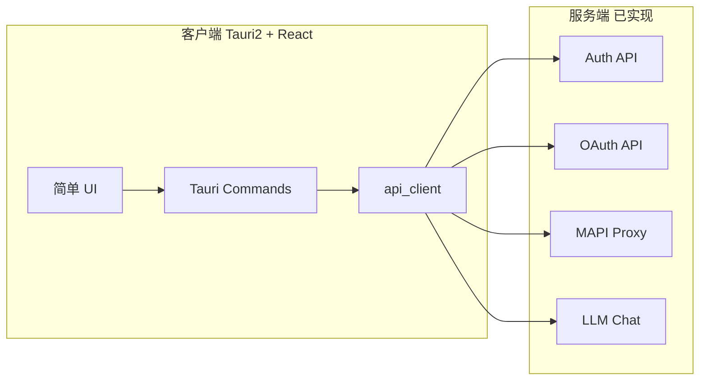

# 基于当前服务端的客户端联调实现方案

## 目标与范围

- **框架**：[prd/Admiral_v1_Architecture.md](prd/Admiral_v1_Architecture.md) 第 7 节客户端架构、第 8 节认证、第 17 节接口总览。
- **服务端现状**：[README.md](README.md) 已实现 Phase 1–4：认证、B 站 OAuth、账户绑定、MAPI 代理、LLM 聊天；Phase 5（WebSocket、Agent、任务系统）待开始。
- **客户端现状**：[crates/admiral-client](crates/admiral-client) 目录与架构 §7.1 一致，但多为占位：`api_client.rs`、`commands/auth.rs`、前端 `App.tsx`/`router.tsx`、`authStore`、`types.ts` 等均为 TODO。
- **本期目标**：实现 REST 调用与简单 UI，完成登录/注册、B 站授权与账户绑定、MAPI 代理、LLM 对话的联调验证；界面可简单（表单+列表+按钮），不实现 WebSocket、Agent Runtime、任务引擎。

---

## 1. 架构与数据流（联调范围）

- 所有请求经 **REST** 完成；WebSocket 本期不实现（服务端 ws 为 stub，Phase 5 待开始）。
- 认证：**Token 仅由 Rust 侧持有**，通过「凭证存储抽象」读写（本期可明文文件或占位实现，接口预留，后续按架构 §19.5 换为加密文件而不改调用方）；前端不持 token，仅通过 command 调 `me()`/`license()` 等拿用户信息展示。请求头 `Authorization: Bearer <access_token>` 在 api_client 内注入；遇 401 用 refresh 换新 token 后重试一次。

---

## 2. 技术栈与未来精美方案的一致性（无冲突约定）

为确保「界面从简」仅指交互与视觉简化，而非换一套技术栈，本期实现**严格对齐** [Admiral_v1_Architecture](prd/Admiral_v1_Architecture.md) §4 与 §7，便于后续直接升级为精美交互而无需重写：

| 层次             | 架构约定                                                                       | 本期做法                                                                                                                     | 与未来关系                                    |
| -------------- | -------------------------------------------------------------------------- | ------------------------------------------------------------------------------------------------------------------------ | ---------------------------------------- |
| 桌面壳            | Tauri 2.x                                                                  | 使用 Tauri 2，启用所需 plugin（如 shell）                                                                                          | 一致，无需替换                                  |
| 前端框架           | React 19+、TypeScript                                                       | 使用现有 React 19、TS（[ui/package.json](crates/admiral-client/ui/package.json) 已具备）                                           | 一致                                       |
| 构建             | Vite 6+                                                                    | 使用现有 Vite 6                                                                                                              | 一致                                       |
| UI 组件与样式       | shadcn/ui + Tailwind CSS 4.x                                               | **本期即引入 shadcn/ui + Tailwind**；「从简」= 用基础组件、少自定义样式，不做主题/动效                                                                | 未来仅做视觉与交互增强，不换组件库                        |
| 状态管理           | Zustand 5+                                                                 | 使用 Zustand（authStore 等）                                                                                                  | 一致                                       |
| 路由             | 前端路由与 §7.3 一致                                                              | 使用 **React Router**（已依赖），路由表与 §7.3 一致（/login、/、/settings、/settings/platforms 等）                                          | 未来仅增路由与页面，不改路由机制                         |
| 前端目录与组件名       | §7.1：layout/AppShell、Sidebar、Header；auth/LoginForm；settings/PlatformAuth 等 | **沿用相同目录与组件文件名**，内容先做最小实现（如 Sidebar 仅占位或简单入口）                                                                            | 未来在同一组件内增强内容与样式，不重命名/重组                  |
| Hooks / Stores | useAuth、useTasks、useWebSocket、useAgent；authStore、taskStore、wsStore、uiStore | **authStore + useAuth 本期完整实现**；taskStore、wsStore、uiStore 与 useTasks、useWebSocket、useAgent **预留为最小占位**（可空状态或空函数），供布局/路由引用 | 未来在占位处补逻辑，不替换 store/hook 体系              |
| 凭证存储           | §19.5 加密文件（Rust 侧）                                                         | **Rust 侧抽象**：如 `CredentialStore` trait 或统一接口，本期实现「明文文件」或「单文件占位」；**前端不存 token**                                           | 后续仅换 Rust 的 Store 实现为加密文件，命令与前端不改        |
| 网络层            | api_client + 未来 ws_client                                                  | 本期只实现 api_client；ws_client 保持占位，命令层通过 api_client 访问服务端                                                                   | Phase 5 增加 ws_client 与命令，与 api_client 并存 |
| 类型             | admiral-types 共享                                                           | 本期在 admiral-types 落齐 API DTO，前端 types.ts 手写与之对应                                                                          | 未来可改为从 Rust 生成 TS 类型，接口不变                |

**结论**：本期不引入架构外的框架或库（如其它 UI 库、其它状态库）；不把 token 放到前端；不偏离 §7.1 的目录与组件命名。这样「从简」仅体现在：每页内容少、交互步骤少、视觉朴素，技术底座与未来精美方案同一套。

---

## 3. 类型与配置对齐

### 3.1 与服务端一致的 DTO

服务端当前在 `admiral-server` 内定义请求/响应类型（如 [api/auth.rs](crates/admiral-server/src/api/auth.rs) 的 `RegisterRequest`、[auth_service](crates/admiral-server/src/service/auth_service.rs) 的 `TokenResponse`、`UserInfo`、`RefreshResponse`、`LicenseResponse`；[api/oauth.rs](crates/admiral-server/src/api/oauth.rs) 的 `BindAccountsRequest`；[api/mapi.rs](crates/admiral-server/src/api/mapi.rs) 的 `MapiProxyRequest`；[api/llm.rs](crates/admiral-server/src/api/llm.rs) 的 `LlmChatRequest`）。

- **方案 A**：在 [crates/admiral-types](crates/admiral-types) 的 `api.rs` 中定义与上述一致的 Serde 类型，供 server 与 client 共用，避免重复与偏差。
- **方案 B**：仅在客户端内定义一份与 4th 文档/README 一致的请求响应类型（不修改 server）。

**建议**：采用方案 A，在 `admiral-types/src/api.rs` 中落齐 auth、oauth、mapi、llm 的请求/响应类型，服务端改为引用这些类型；客户端与前端 TypeScript 类型可手写与之一一对应（或后续用脚本从 Rust 生成）。

### 2.2 客户端配置

- **服务端 Base URL**：可配置（如 `ADMIRAL_API_BASE_URL` 或设置页输入），默认 `http://127.0.0.1:8080`，便于本地联调。
- 从 [.env.example](.env.example) 或 Tauri 环境读 base URL，前端通过 Tauri command 或 inject 获取。

---

## 4. 客户端工程与依赖

- 在 [crates/admiral-client/Cargo.toml](crates/admiral-client/Cargo.toml) 中**取消注释**并固定版本：`tauri`、`tauri-plugin-shell`、`reqwest`（含 json、rustls-tls）、`serde`/`serde_json`（若未从 workspace 继承则显式声明）。
- 凭证存储：Rust 侧实现 `CredentialStore` 抽象（见 §2 表），本期可用明文文件或占位；若后续做加密再启用 `aes-gcm`、`zeroize`。
- 本地 DB（rusqlite）、WebSocket（tokio-tungstenite）、cron 本期可不启用。
- 确认 Tauri 2 结构（如 `src-tauri` 与 `ui` 的目录）与架构 §7.1 一致；当前为 `ui/` 时保持 `ui/`，路由与入口在 `ui/` 内完成。
- **前端**：在 [ui/package.json](crates/admiral-client/ui/package.json) 中补充 **shadcn/ui** 所需依赖（按 shadcn 文档，通常含 `class-variance-authority`、`clsx`、`tailwind-merge` 及若干 Radix 组件）；样式已具备 Tailwind 4，可直接用 shadcn 组件做「简单但统一」的 UI。

---

## 5. 网络层：api_client

在 [crates/admiral-client/src/network/api_client.rs](crates/admiral-client/src/network/api_client.rs) 中实现（与 §2 约定一致，仅 REST，token 由调用方传入或从 Rust 侧 CredentialStore 读取后注入）：

- **构造**：`ApiClient::new(base_url: String)`，内部使用 `reqwest::Client`（建议超时 10–30s）。
- **认证相关**：  
`register`、`login`、`refresh`、`me`、`license`，路径与 [README 的 API 列表](README.md) 一致（如 `POST /api/v1/auth/register`、`POST /api/v1/auth/login`、`POST /api/v1/auth/refresh`、`GET /api/v1/auth/me`、`GET /api/v1/auth/license`）。  
请求体/响应体使用与服务端一致的 DTO（来自 admiral-types 或本地复刻）。
- **OAuth 相关**：  
`oauth_initiate` → `POST /api/v1/oauth/bilibili/initiate`，返回 `authorization_url`；  
`oauth_status` → `GET /api/v1/oauth/bilibili/status`；  
`oauth_accounts_list(oauth_session_id?)` → `GET /api/v1/oauth/bilibili/accounts`（可选 query）；  
`oauth_bind_accounts(oauth_token_id, account_ids)` → `POST /api/v1/oauth/bilibili/bind-accounts`；  
`oauth_delete_session(id)` → `DELETE /api/v1/oauth/bilibili/sessions/:id`。  
以上除 initiate 外均需在 Header 带 `Authorization: Bearer <access_token>`。
- **MAPI**：`mapi_proxy(account_id, method, path, query?, body?)` → `POST /api/v1/mapi/proxy`，Body 与 [mapi.rs](crates/admiral-server/src/api/mapi.rs) 的 `MapiProxyRequest` 一致，Header 带 JWT。
- **LLM**：`llm_chat(messages, stream?, model?, max_tokens?)` → `POST /api/v1/llm/chat`，支持 `stream: false`（返回 JSON）与 `stream: true`（返回 SSE 流）；Header 带 JWT。
- **错误处理**：将 HTTP 4xx/5xx 与 body 中的 `code`/`message` 映射为客户端可展示的错误类型（如未授权、邀请码无效、B 站错误等），便于 UI 提示。

推荐：在 Command 层统一「从 CredentialStore 取 token → 调 ApiClient → 若 401 则 refresh 后重试」，ApiClient 仅接受可选 token 参数，便于单测与复用。

---

## 6. Tauri Commands（与 API 一一对应）

在 [crates/admiral-client/src/commands/auth.rs](crates/admiral-client/src/commands/auth.rs) 中实现：

- `register(email, password, name, company?, invite_code)` → 调用 api_client.register，成功后写入本地 token 与 user，返回前端所需信息。
- `login(email, password)` → 调用 api_client.login，同上写入 token/user。
- `refresh()` → 用当前 refresh_token 调 api_client.refresh，更新 access_token。
- `logout()` → 仅清空本地 token/user（服务端 logout 可选）。
- `me()`、`license()` → 需 JWT，调用 api_client 并返回结果。

在 `commands/` 下可新增 `oauth.rs`、`mapi.rs`、`llm.rs`（或合并到 `settings.rs`），对应：

- OAuth：initiate（返回 url，由前端用 `open()` 打开浏览器）、status、accounts_list、bind_accounts、delete_session。
- MAPI：proxy(account_id, method, path, query?, body?) → 直接转发 api_client 结果。
- LLM：chat(messages, stream?, model?, max_tokens?) → 转发 api_client，流式时可通过 Tauri 事件或 channel 把 SSE 块推给前端。

Token 存储：**仅 Rust 侧**。Command 从 `CredentialStore` 读 token 调用 api_client，登录/刷新成功后写回 `CredentialStore`；前端不持有、不传 token，仅通过 command 获取用户信息与接口结果（与 §2 一致）。

---

## 7. 前端：路由与页面（从简）

与架构 §7.3 对齐，且**沿用 §7.1 的组件与目录名**（§2），仅内容从简：

- `**/login`**：使用 **layout + auth/LoginForm**（及可选 InviteCodeInput）。登录/注册 Tab；表单用 **shadcn 组件**（Input、Button、Tabs）。提交调用 Tauri `login`/`register`（token 仅写 Rust 侧），成功跳转 `/`。
- `**/`**：使用 **AppShell、Sidebar、Header** 布局；主区展示 `me()`、`license()`（通过 command 取，不读 token）；入口：设置、B 站授权、MAPI 调试、LLM 对话。
- `**/settings`**、`**/settings/platforms`**：使用 **settings/PlatformAuth** 等；B 站：initiate → `open()` 打开浏览器；status 列表 + delete_session；accounts_list + bind_accounts；UI 用 shadcn Table/Checkbox/Button。
- **MAPI 联调**：设置下或单独页；表单（Input、Select）+ 发送 → mapi proxy command，展示响应（可简单 pre/code）。
- **LLM 联调**：简单对话页（或复用 chat/ChatPanel 占位）；输入 + 发送 → llm chat command（先非流式），展示回复。

前端状态：**authStore** 存 user、license 等（从 command 拉取，不存 token）；**taskStore、wsStore、uiStore** 保持最小占位。**types.ts** 与 admiral-types/api 对齐。路由使用 **React Router**，与 §7.3 路径一致。

---

## 8. 实现顺序建议

| 顺序  | 内容                            | 说明                                                                                   |
| --- | ----------------------------- | ------------------------------------------------------------------------------------ |
| 1   | 类型与配置                         | admiral-types api 类型；客户端 base_url；Rust CredentialStore 抽象（本期明文或占位）                   |
| 2   | api_client 与 auth commands    | 实现 auth 全链路；Command 从 CredentialStore 读/写 token，api_client 注入 Bearer                 |
| 3   | 登录/注册 UI 与首页                  | 引入 shadcn/ui；React Router；layout + LoginForm；首页 AppShell/Sidebar/Header + me/license |
| 4   | OAuth commands + 设置页 B 站授权与绑定 | initiate → 打开浏览器；status/accounts/bind/delete + 简单列表与表单                               |
| 5   | MAPI proxy command + 简单调试 UI  | 表单填 account_id/path/method 等，展示响应                                                    |
| 6   | LLM chat command + 简单对话 UI    | 非流式对话，验证 LLM 代理                                                                      |

WebSocket、Agent Runtime、任务引擎、Skill 执行、加密 JWT 存储（换 CredentialStore 实现）等留待 Phase 5 或后续迭代。

---

## 9. 联调验证检查项

- 注册：邀请码有效/无效/已使用、邮箱重复等错误提示正确。
- 登录：成功返回 token 与 user；失败提示正确。
- 刷新：access 过期后自动或手动 refresh 能拿到新 token 并继续请求。
- B 站授权：initiate 拿到 URL，浏览器授权后回调由服务端处理，客户端 status 能看到新授权；能拉取账户列表并绑定。
- MAPI：已绑定 account 的 token 下，调用 proxy 能拿到 B 站正常响应；未绑定或错误 account_id 得 403/401。
- LLM：带 JWT 调 chat 能收到模型回复；未配置或 key 错误时服务端 502/503，客户端有友好提示。

---

## 10. 涉及文件摘要

| 层次    | 文件/目录                                                     | 动作                                    |
| ----- | --------------------------------------------------------- | ------------------------------------- |
| 类型    | `crates/admiral-types/src/api.rs`                         | 定义 auth/oauth/mapi/llm 请求响应类型；服务端改为引用 |
| 配置    | 客户端 base_url；Rust 侧 CredentialStore 抽象（本期明文或占位）           | 新增或使用现有 config                        |
| 网络    | `crates/admiral-client/src/network/api_client.rs`         | 实现完整 REST 调用与错误映射                     |
| 命令    | `commands/auth.rs`、`oauth.rs`、`mapi.rs`、`llm.rs`（或合并）     | 实现 Tauri commands 调用 api_client       |
| 前端    | `ui/src/App.tsx`、`router.tsx`，登录页、首页、设置/平台授权、MAPI/LLM 调试页 | 简单表单与列表                               |
| 状态与类型 | `ui/src/stores/authStore.ts`、`lib/types.ts`               | 实现并对齐服务端 DTO                          |

以上方案在不动服务端业务逻辑的前提下，仅通过「类型统一 + 客户端实现 REST + 简单 UI」即可完成当前阶段的联调与基本功能验证。