# 服务端实现计划（基于 4thdoc-服务端开发方案）

## 现状与依据

- **代码现状**：[crates/admiral-server](crates/admiral-server) 仅有目录骨架，所有模块为 TODO 占位；[main.rs](crates/admiral-server/src/main.rs) 仅打印 "not yet implemented"；Cargo.toml 中 axum、sea-orm、jsonwebtoken 等依赖均被注释；无 [migrations](crates/admiral-server/migrations) 目录。
- **需求与架构**：实现范围与接口以 [prd/4thdoc-服务端开发方案.md](prd/4thdoc-服务端开发方案.md) 为准；技术栈与模块划分对齐 [prd/Admiral_v1_Architecture.md](prd/Admiral_v1_Architecture.md)；遇冲突时按 4th 文档的「扩展设计」执行（见下）。

## 框架性差异处理（4th vs 架构文档）

| 点            | 架构文档                                 | 4th 文档                                        | 采用                                                                                        |
| ------------ | ------------------------------------ | --------------------------------------------- | ----------------------------------------------------------------------------------------- |
| oauth_tokens | `UNIQUE(user_id, platform)` 每用户每平台一条 | 允许多条（一次授权一条）                                  | **4th**：去掉唯一约束，保留 `id` 主键                                                                 |
| 账户绑定         | ad_accounts 表                        | 需 (user_id, account_id) → 唯一对应一条 oauth_tokens | **4th**：新建 `ad_account_bindings(user_id, platform, account_id, oauth_token_id)` 唯一约束      |
| 邀请码          | invites 有 max_uses/used_count        | 一次性：使用后 used_count=1 或 status='used'          | **4th**：校验 `used_count < max_uses` 且未过期，注册后立即标记已使用                                        |
| 环境变量         | —                                    | B 站用 `APP_ID`/`APP_SECRET`                    | 与 4th 一致；[.env.example](.env.example) 中 `BILI_CLIENT_ID/SECRET` 建议改为 `BILI_APP_ID/SECRET` |

---

## 阶段 0：依赖与基础设施

**目标**：服务能启动、能连库、能读配置、能记录日志、能返回统一错误。

- **Cargo.toml**  
启用并锁定版本：axum 0.8、tower/tower-http（cors、trace、request-id）、sea-orm（sqlx-postgres、runtime-tokio-rustls）、jsonwebtoken、argon2、aes-gcm、moka（future）、reqwest（json、rustls-tls）、config、tracing-subscriber（env-filter、json）。若需限流再启用 governor。
- **config.rs**  
使用 config-rs：合并 `config/default.toml`、`development.toml`/`production.toml` 及环境变量；暴露 `ServerConfig`、`DatabaseConfig`、`AuthConfig`（JWT TTL）、`BilibiliOAuthConfig`、`LlmConfig` 等。敏感项（`ADMIRAL_DATABASE_URL`、`ADMIRAL_JWT_`*、`ADMIRAL_TOKEN_ENCRYPTION_KEY`、`ADMIRAL_BILI_`*、`ADMIRAL_*_API_KEY`）仅从环境变量读取，与 [4th §9](prd/4thdoc-服务端开发方案.md) 清单一致；B 站使用 `ADMIRAL_BILI_APP_ID` / `ADMIRAL_BILI_APP_SECRET` / `ADMIRAL_BILI_CALLBACK_URL`。
- **error.rs**  
定义 `AppError`（thiserror + 与业务错误码对应），实现 `IntoResponse`：映射为 HTTP 状态码 + JSON body（如 `{ "code": "...", "message": "..." }`）。提供 `Result<T, AppError>` 别名。
- **infra/db.rs**  
使用 SeaORM：从配置读 `ADMIRAL_DATABASE_URL`，创建 `DatabaseConnection`（连接池），导出 `get_db()` 或注入用类型。
- **middleware**  
  - **request_id**：为每个请求生成/传播 `X-Request-Id`。  
  - **logging**：tracing 记录请求方法、路径、状态码、耗时。  
  （rate_limiter 可阶段一再加，用于登录限流。）
- **main.rs**  
加载 config、初始化 tracing_subscriber、连接 DB、创建 Axum app（挂载健康检查或占位路由）、绑定 `ADMIRAL_SERVER_HOST:PORT` 并 serve。暂不挂业务路由，确认能跑通。

---

## 阶段一：认证与用户（4th §3、§10.1）

**目标**：注册（邀请码一次性）、登录、刷新、me、license；JWT 鉴权中间件。

- **数据库迁移 1**  
  - `users`：id, email(unique), password_hash, name, company, role, status, created_at, updated_at（与架构 §16.1 一致）。  
  - `invites`：id, code(unique), trial_days, max_uses(默认 1), used_count(默认 0), created_by, expires_at, created_at。  
  - `entitlements`：id, user_id, invite_id, type, starts_at, expires_at, is_active, extended_by, extend_reason, created_at。  
  - `devices`（可选）：本期可不实现踢设备，表可先建留空。  
  使用 SeaORM `sea-orm-migration` 在 [crates/admiral-server/migrations](crates/admiral-server/migrations) 下添加首份迁移。
- **SeaORM entities**  
生成或手写 `users`、`invites`、`entitlements`（及可选 `devices`）的 entity，放在 `src/domain` 或新建 `src/entities`（按你现有习惯），在 domain 层做业务模型封装（如 Invite 的「未使用且未过期」校验）。
- **JWT**  
RS256：从配置读私钥/公钥路径，加载 PEM。Claims 含 `sub`(user_id)、`exp`、`iat`、`token_type`("access"|"refresh")。access 2 小时、refresh 30 天（与 4th §3.3 一致）。
- **auth_service**  
  - 注册：校验邀请码（未使用：used_count < max_uses；未过期：expires_at）；创建 user（argon2 哈希密码）；创建 entitlement（trial，starts_at=NOW, expires_at=starts_at+trial_days）；将邀请码标记已使用（used_count += 1 或 status='used'）；签发 JWT 返回（与登录相同 body）。  
  - 登录：按 email 查 user，argon2 校验密码，签发 JWT。  
  - 刷新：校验 refresh_token，签发新 access_token，返回 4th §3.5 格式。  
  - me：根据 user_id 查 user 并返回简要信息。  
  - license：根据 user_id 查当前有效 entitlement，返回试用期/有效期状态。
- **api/auth**  
  - `POST /api/v1/auth/register`：body 含 email, password, name, company, invite_code；返回 201 + Token 体（同登录）。  
  - `POST /api/v1/auth/login`：body 含 email, password；返回 200 + 4th §3.5 的 JSON（access_token, refresh_token, expires_in, token_type, user）。  
  - `POST /api/v1/auth/refresh`：body 含 refresh_token；返回新 access_token、expires_in、token_type。  
  - `GET /api/v1/auth/me`：需 JWT；返回当前用户信息。  
  - `GET /api/v1/auth/license`：需 JWT；返回权益/有效期。  
  - `POST /api/v1/auth/logout`（可选）：可仅客户端弃 token，或做 refresh 拉黑表（本期可占位）。
- **middleware/auth_guard**  
从 `Authorization: Bearer <access_token>` 解析 JWT，校验签名与过期，将 `user_id`（或 Claims）放入 request extensions，供 handler 使用。未带/无效 token 返回 401。
- **router**  
挂载 `/api/v1/auth` 下上述路由；`me`、`license`、`logout` 使用 auth 中间件。
- **统一响应**  
成功与错误均使用 4th/架构约定的 JSON 形状；错误时用 [error.rs](crates/admiral-server/src/error.rs) 的 code + message。

---

## 阶段二：MAPI OAuth2.0 与 Token 存储（4th §4、§10.2）

**目标**：发起授权、回调换 Token、多 Token 存储与加密、状态查询、删除会话、每 10 小时刷新。

- **配置**  
在 config 中增加 B 站：APP_ID、APP_SECRET、CALLBACK_URL（与 4th §4.2 一致）；Token 加密：ADMIRAL_TOKEN_ENCRYPTION_KEY（32 字节 hex）。
- **infra/crypto.rs**  
AES-256-GCM：固定 nonce 或每条 token 一个 nonce（与 4th 一致：token_nonce 存库）；提供 `encrypt(plaintext, key) -> (ciphertext, nonce)`、`decrypt(ciphertext, nonce, key)`。
- **数据库迁移 2**  
  - `oauth_tokens`：id(UUID), user_id, platform(default 'bilibili'), access_token_encrypted(BYTEA), refresh_token_encrypted(BYTEA), token_nonce(BYTEA), expires_at, refresh_expires_at, created_at, updated_at。**不设** UNIQUE(user_id, platform)。  
  - 索引：idx_oauth_tokens_user_platform。
- **token_vault**  
封装：写入时加密 access/refresh，写入 oauth_tokens 一行；按 id 读取时解密返回；按 user_id 列表读取（供 status 用）。依赖 infra/crypto 与 oauth_tokens 的 repo/entity。
- **oauth_service**  
  - initiate：生成 state(UUID)，(state -> user_id) 存入 moka TTL 10 分钟；返回 `authorization_url`（4th §4.2 的 B 站授权页 URL）。  
  - callback：query 取 code、state；用 state 取 user_id，无效则 400；POST 到 B 站换 token（application/x-www-form-urlencoded）；解析 data.access_token、refresh_token、expires_in；写入 oauth_tokens（多 Token：每次一条新记录），加密由 token_vault 完成；返回 HTML「授权成功，请关闭窗口」或重定向。  
  - status：按 user_id 查 oauth_tokens（不返回明文 token），返回各条 id、platform、created_at 等。  
  - delete session：校验该 id 属于当前 user_id，删除该条 oauth_tokens。
- **api/oauth**  
  - `POST /api/v1/oauth/bilibili/initiate`：需 JWT；返回 `{ "authorization_url": "..." }`。  
  - `GET /api/v1/oauth/bilibili/callback`：**常驻路由**，无需 JWT；query code/state；调用 oauth_service.callback。  
  - `GET /api/v1/oauth/bilibili/status`：需 JWT；返回当前用户各次授权列表。  
  - `DELETE /api/v1/oauth/bilibili/sessions/:id`：需 JWT；删除指定会话。
- **token_refresh_job**  
后台任务：每 10 小时（或可配置）扫描 oauth_tokens（按 expires_at 或「下次刷新时间」）；对每条用 refresh_token 调 B 站刷新接口；成功则用 token_vault 更新该条；失败则标记失效或删除并记日志。可在 main 里 spawn 一个 loop + sleep，或使用 tokio::time::interval。
- **router**  
挂载 `/api/v1/oauth/bilibili` 下上述路由；callback 不经过 auth 中间件。

---

## 阶段三：广告账户绑定与 MAPI 转发（4th §5、§6、§10.3）

**目标**：按某次授权拉取 B 站账户列表、用户多选绑定、MAPI 代理按 account_id 注入 Token 转发。

- **数据库迁移 3**  
  - `ad_account_bindings`：id, user_id, platform, account_id, oauth_token_id(FK oauth_tokens.id), account_name(可选), created_at；UNIQUE(user_id, platform, account_id)。  
  - 索引：idx_ad_account_bindings_user_platform；便于按 (user_id, account_id) 查 oauth_token_id。
- **B 站接口**  
获取广告主列表：`GET https://cm.bilibili.com/takumi/api/open_api/oauth2/advertisers?page=1&size=100`，Header `Authorization: Bearer {access_token}`（4th 附录 A）。  
使用 reqwest，access_token 由 token_vault 按 oauth_token_id 解密得到。
- **service**  
  - 账户列表：根据 JWT user_id + 可选 `oauth_session_id`（即 oauth_tokens.id）确定一条 token；若无则用该用户最近一条有效授权；用其 access_token 调 B 站 advertisers；返回 records、total。  
  - 绑定：接收 oauth_token_id、account_ids[]；校验 oauth_token_id 属于当前 user_id；对每个 account_id 插入/更新 ad_account_bindings(user_id, platform, account_id, oauth_token_id)。
- **api/accounts**  
  - `GET /api/v1/oauth/bilibili/accounts?oauth_session_id={id}` 或省略（默认最近授权）；需 JWT；返回 B 站格式的 records/total。  
  - `POST /api/v1/oauth/bilibili/bind-accounts`：body `{ "oauth_token_id", "account_ids" }`；需 JWT。
- **mapi_proxy**  
  - 输入：user_id、account_id、method、path、query、body。  
  - 查 ad_account_bindings(user_id, platform='bilibili', account_id) 得 oauth_token_id；若不存在返回 403。  
  - 用 token_vault 取该 oauth_token_id 的 access_token（若接近过期可先尝试刷新再取）。  
  - 拼接 URL：`https://cm.bilibili.com/takumi/api/{path}` + query；构造请求 Method、Header `Authorization: Bearer {access_token}`、body 原样；reqwest 转发，响应状态码与 body 原样返回（或脱敏日志）。  
  - 可选：写 mapi_audit_logs（4th §8.4）。
- **api/mapi**  
  - `POST /api/v1/mapi/proxy`（或 `/api/v1/mapi/execute` 与架构一致）：body 必须含 account_id、method、path，可选 query、body；JWT 校验后调 mapi_proxy，返回 B 站响应或 403/502 与错误信息。
- **router**  
挂载 accounts 与 mapi 路由；mapi 与 accounts 均需 JWT。

---

## 阶段四：大模型调用（4th §7、§10.4）

**目标**：单模型代理，管理员配置默认模型与 API Key；支持 stream / 非 stream。

- **配置**  
ADMIRAL_LLM_DEFAULT_PROVIDER（deepseek|doubao|chatgpt|gemini）、各 ADMIRAL_DEEPSEEK_API_KEY 等（4th §9.1）；仅环境变量。
- **llm_proxy（或沿用 llm_router 文件名）**  
  - 根据 default provider 选择厂商；若该厂商 API Key 未配置则返回 503。  
  - 请求体：messages、stream（bool）。  
  - 使用 reqwest 调对应厂商（DeepSeek/OpenAI 兼容/Doubao/Gemini）；stream=true 时转发 SSE；stream=false 时返回 JSON（如 choices[0].message.content）。  
  - 可抽象 `LlmProvider` trait，各厂商一实现，便于后续扩展路由。
- **api/llm**  
  - `POST /api/v1/llm/chat`：需 JWT；body 含 messages、stream（默认 true 或按 4th）；调用 llm_proxy；返回 SSE 或 JSON。  
  - 错误：未配置 Key、厂商错误 → 502/503，不泄露 Key。
- **router**  
挂载 `/api/v1/llm`。

---

## 收尾与一致性

- **router.rs**  
汇总：`/api/v1/auth`、`/api/v1/oauth/bilibili`（含 callback、accounts、bind-accounts、status、sessions/:id）、`/api/v1/mapi/proxy`、`/api/v1/llm/chat`；CORS、request_id、logging 中间件；需要鉴权的路由使用 auth_guard 层。
- **main.rs**  
完整启动链：config → tracing → db → 可选 cache(moka) → token_refresh_job spawn → Axum app（router）→ bind & serve。
- **.env.example**  
与 4th §9.1 对齐：B 站改为 `ADMIRAL_BILI_APP_ID`、`ADMIRAL_BILI_APP_SECRET`、`ADMIRAL_BILI_CALLBACK_URL`；补充 LLM 相关键（DEFAULT_PROVIDER、各 *_API_KEY）；保留 JWT、TOKEN_ENCRYPTION_KEY、DATABASE_URL 等。
- **admin 接口**  
4th 范围含「管理员：用户/邀请码/LLM 配置」；若本期只做「邀请码创建」与「用户列表/延长有效期」，可先实现 [api/admin.rs](crates/admiral-server/src/api/admin.rs) 的 GET/POST invites、POST users/:id/extend，并加 admin role 校验（auth_guard 扩展或单独中间件）。

---

## 实现顺序小结

```mermaid
flowchart LR
  subgraph phase0 [阶段0]
    A0[Cargo + config + error + db + middleware]
    A1[main 启动]
  end
  subgraph phase1 [阶段一]
    B1[migrations users invites entitlements]
    B2[auth_service + JWT + auth_guard]
    B3[api/auth 路由]
  end
  subgraph phase2 [阶段二]
    C1[crypto + token_vault + oauth_tokens 迁移]
    C2[oauth_service + callback 常驻]
    C3[token_refresh_job]
    C4[api/oauth]
  end
  subgraph phase3 [阶段三]
    D1[ad_account_bindings 迁移]
    D2[accounts 列表与绑定]
    D3[mapi_proxy + api/mapi]
  end
  subgraph phase4 [阶段四]
    E1[llm_proxy + api/llm]
  end
  phase0 --> phase1
  phase1 --> phase2
  phase2 --> phase3
  phase3 --> phase4
```

建议严格按阶段 0 → 1 → 2 → 3 → 4 实现，每阶段完成后可单独验证（如阶段一用 curl 测注册/登录/me），再进入下一阶段。